<p align="center">
  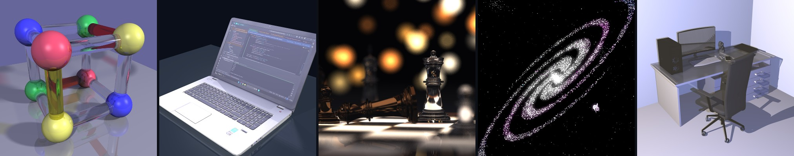
</p>

<h1 align="center">Java Ray Tracer</h1>

<p align="center">
  A ray tracer written from scratch in pure Java - no graphics libraries, just math and careful design.
</p>

<p align="center">
  <a href="https://github.com/itzik123/ISE5786_8332_7818/actions/workflows/ci.yml"></a>
  
  
  
  <a href="LICENSE"></a>
</p>

---

We built this engine in a university software engineering course and kept going after it ended.
It renders glass that bends light the way real glass does, soft shadows, depth of field and
glossy reflections, and it handles models with hundreds of thousands of triangles thanks to two
spatial indexes and multithreading.

## Gallery

<table>
  <tr>
    <td colspan="2">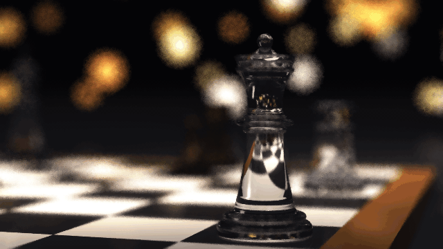</td>
  </tr>
  <tr>
    <td colspan="2" align="center"><b>The Final Move</b><br>
      Five seconds, every frame rendered by the engine. The king's fall is a rigid-body simulation, and
      each frame averages four renders across the shutter for motion blur - their spread guides a
      denoiser that keeps edges sharp.<br>
      <sub>50 frames at 640×360, rendered as 200 sub-frames in under two and a half hours on a laptop</sub></td>
  </tr>
  <tr>
    <td width="50%">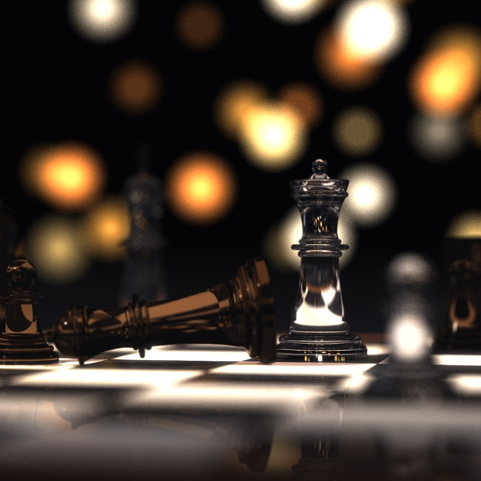</td>
    <td width="50%">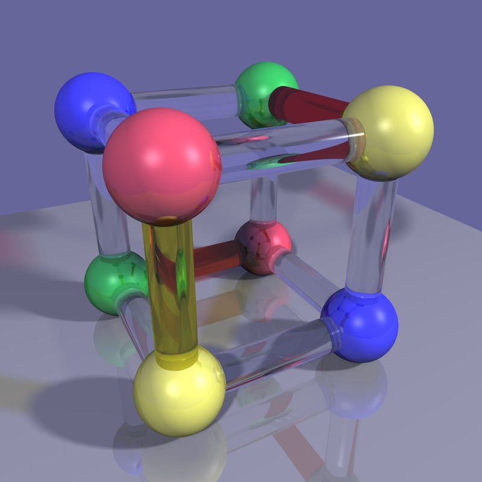</td>
  </tr>
  <tr>
    <td align="center"><b>Checkmate</b><br>
      Glass pieces turned from hand-drawn profiles, with depth of field and soft shadows. Everything
      is generated by code.</td>
    <td align="center"><b>Glass Cube</b><br>
      Solid glass rods that refract and reflect by Snell's law and Fresnel's equations, tinting their
      own shadows.</td>
  </tr>
  <tr>
    <td>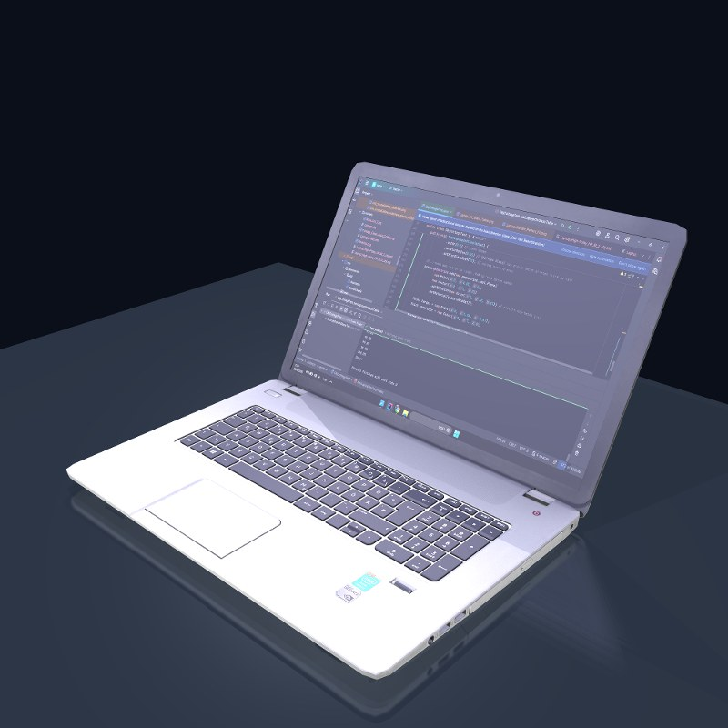</td>
    <td>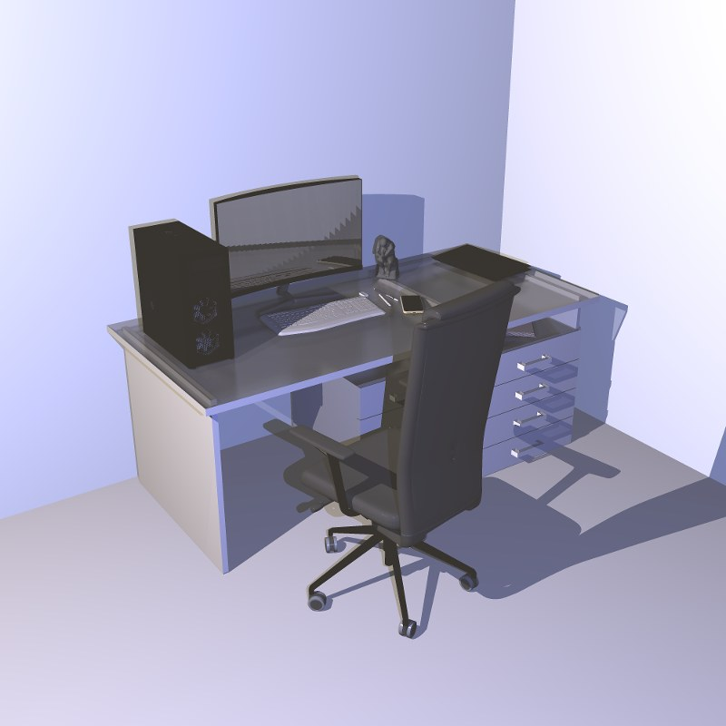</td>
  </tr>
  <tr>
    <td align="center"><b>Laptop</b><br>A 130,000-triangle textured model on a glass table.</td>
    <td align="center"><b>Workstation</b><br>About 650,000 triangles, rendered with the octree.</td>
  </tr>
  <tr>
    <td>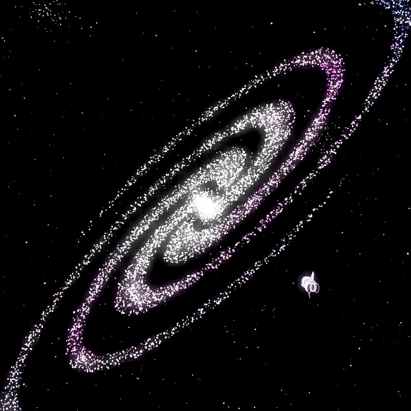</td>
    <td>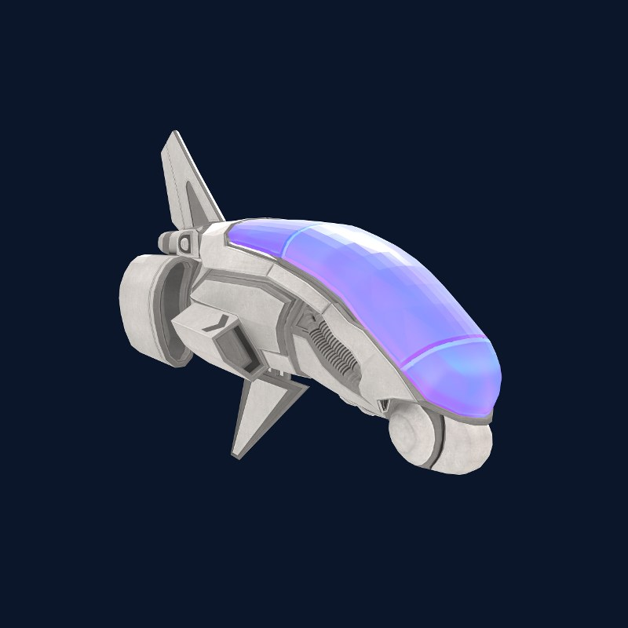</td>
  </tr>
  <tr>
    <td align="center"><b>Milky Way</b><br>Over 11,000 semi-transparent stars and about 200 lights, finished
      with bloom.</td>
    <td align="center"><b>E-45 Aircraft</b><br>A textured model, with texture coordinates interpolated across
      every triangle.</td>
  </tr>
</table>

<details>
<summary><b>Before and after</b></summary>
<br>

**Anti-aliasing** - one ray per pixel against 121 jittered rays per pixel:

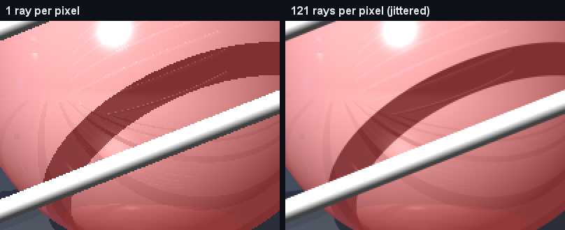

**Bloom** - bright highlights spill a soft glow over their surroundings:

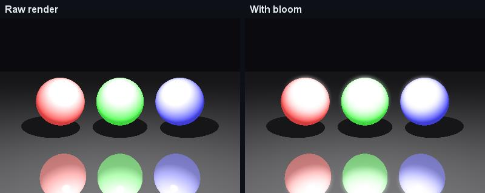

</details>

## Features

**Light and materials** - recursive ray tracing with Phong shading; glass with refraction, total
internal reflection and Fresnel reflectance; glossy and frosted surfaces; soft shadows from area
lights; shadows tinted by the glass they pass through; depth of field.

**Geometry** - spheres, planes, polygons, triangles, tubes and cylinders; smooth-shaded meshes;
surfaces of revolution; textured OBJ/MTL models; scenes described in XML.

**Speed and image quality** - a regular grid and an adaptive octree; multithreading; jittered and
adaptive super-sampling; bloom, FXAA, color grading and sharpening filters.

## How an image is rendered

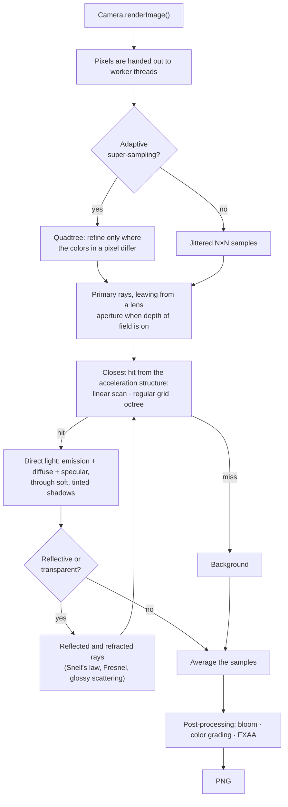

Each pixel is sampled by several rays. A ray asks the acceleration structure for its closest hit,
gathers the light that reaches that point, and spawns reflected and refracted rays until their
contribution fades.

## Architecture

The scene - every shape is an `Intersectable`, and so is a group of shapes:

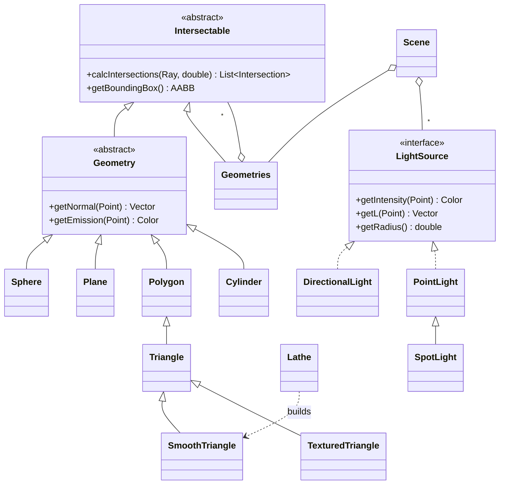

The renderer - each concern sits behind its own abstraction:

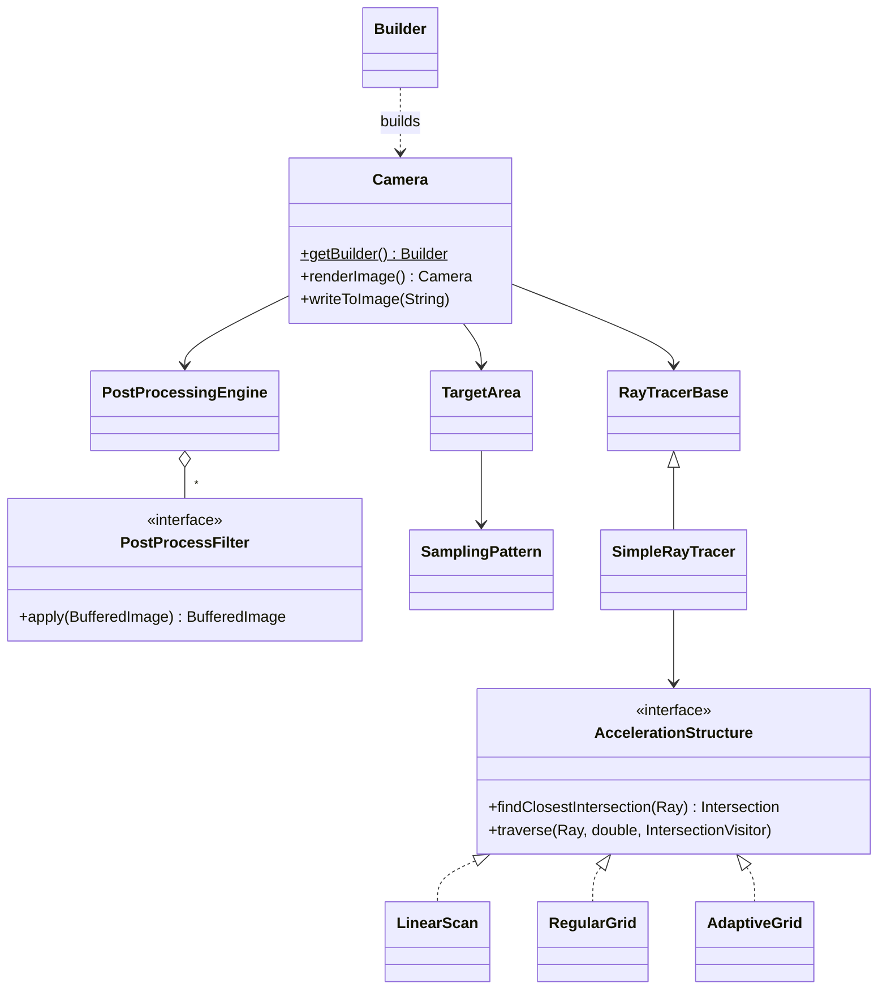

| Pattern | Where | Why |
|---|---|---|
| **Builder** | `Camera.Builder` | Many optional settings, validated once |
| **Strategy** | `AccelerationStructure`, `SamplingPattern` | Swap the spatial index or sampling scheme without touching the shading code |
| **Composite** | `Geometries` | A model or a whole scene is intersected like a single shape |
| **Template Method** | `Intersectable.calcIntersections`, `PixelFilter.apply` | The base class fixes the contract, subclasses fill in one step |
| **Visitor** | `AccelerationStructure.IntersectionVisitor` | Shadow rays stop as soon as the light is blocked |
| **Pipeline** | `PostProcessingEngine` | Filters compose in any order |

## Performance

Single thread, one ray per pixel, on an Intel Core i5-13420H laptop. All three strategies render
identical images.

| Scene | Objects | Image | Linear scan | Regular grid | Octree |
|---|---:|---:|---:|---:|---:|
| Utah teapot + 400 glass bubbles | 1,392 | 1000×1000 | 23.0 s | 0.89 s | 1.15 s |
| Laptop on a glass table | 130,351 | 400×400 | 43.6 **min** | 0.83 s | 0.98 s |

On top of that, ten threads render 6.7× faster than one, and adaptive super-sampling takes half
the time of a fixed 5×5 grid.

## Testing

- 132 JUnit tests, designed with equivalence partitioning and boundary value analysis, cover the
  math, every shape, lights, the camera, sampling, filters, the scene loaders and reference
  renders.
- The grid and the octree are checked against brute force on thousands of random rays.
- The XML loader is tested against XXE attacks.
- GitHub Actions builds and tests every push. Heavy renders and benchmarks are kept in a separate
  `showcase` group.

## Getting started

You need JDK 25 and Maven 3.9 or later.

```bash
git clone https://github.com/itzik123/ISE5786_8332_7818.git
cd ISE5786_8332_7818
mvn test
```

Rendered images are written to `images/`. To render one of the showcase scenes:

```bash
mvn test -Pshowcase -Dtest=SceneShowcaseTest#testGlassCube
```

The animation is rendered the same way, one PNG per frame in `images/checkmate`:

```bash
mvn test -Pshowcase -Dtest=CheckmateAnimationTest
```

### A scene in code

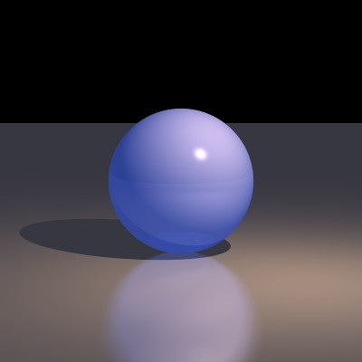

```java
Scene scene = new Scene("Demo").setAmbientLight(new AmbientLight(new Color(25, 25, 30)));
scene.geometries.add(
        new Sphere(new Point(0, 0, -100), 50)
                .setEmission(new Color(20, 40, 120))
                .setMaterial(new Material().setKd(0.5).setKs(0.5).setShininess(100).setKr(0.2)),
        new Plane(new Point(0, -50, 0), Vector.AXIS_Y)
                .setEmission(new Color(30, 30, 35))
                .setMaterial(new Material().setKd(0.5).setKr(0.4)
                        .setBlurRadius(0.05).setBlurGlassRays(16)));   // glossy floor
scene.lights.add(new SpotLight(new Color(900, 700, 500),
        new Point(100, 150, 50), new Vector(-1, -1.5, -1.5)).setKl(0.0005).setKq(0.00005));

Camera.getBuilder()
        .setRayTracer(scene, RayTracerType.ADAPTIVE_GRID)
        .setLocation(new Point(0, 40, 400)).setDirection(new Point(0, 0, -100))
        .setVpSize(200, 200).setVpDistance(400)
        .setResolution(800, 800)
        .setAntiAliasing(3, new Jittered())    // 3×3 rays per pixel
        .setMultithreading(-2)                 // all cores but two
        .addPostProcessFilter(new BloomFilter())
        .build()
        .renderImage()
        .writeToImage("demo");                 // images/demo.png
```

Scenes can also be loaded from XML files - see [`scenes/`](scenes).

## Authors

- [**itzik123**](https://github.com/itzik123)
- [**ityy35-bit**](https://github.com/ityy35-bit)

## Acknowledgments

Built in the *Introduction to Software Engineering* course (ISE 5786). The course lecturer, Dan
Zilberstein, provided the overall design and a few base classes, which keep his `@author` tag.
The HP laptop and E-45 aircraft models are by 3dhaupt and the cottage is by gerhald3d, all from
Free3D, and the workstation is a free model by its original author. These models are free for
personal use and are not included in this repository. The
teapot is Martin Newell's 1975 Utah teapot.

## License

Released under the [MIT License](LICENSE).
